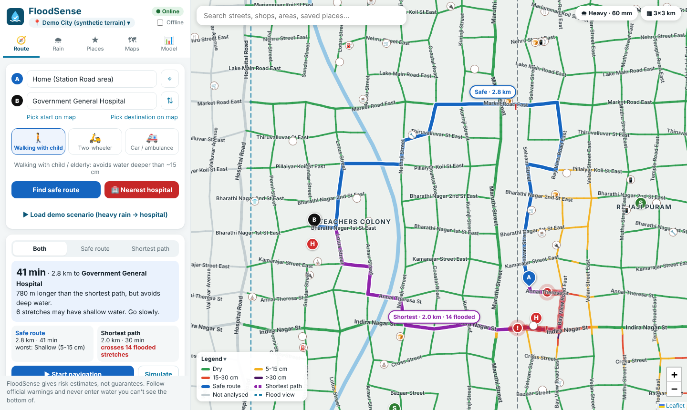
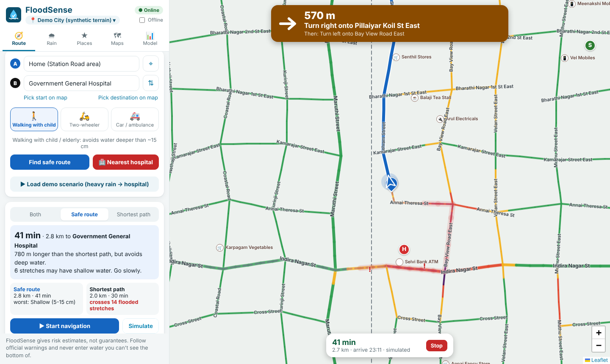
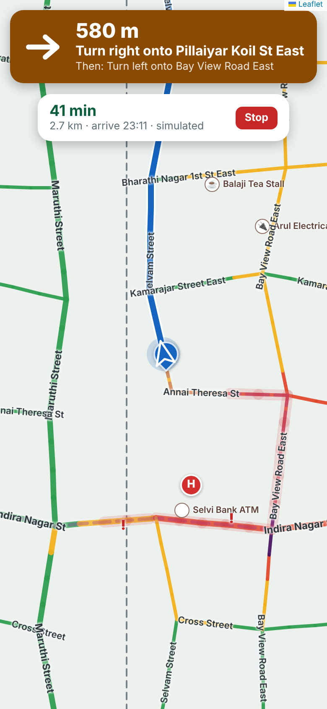
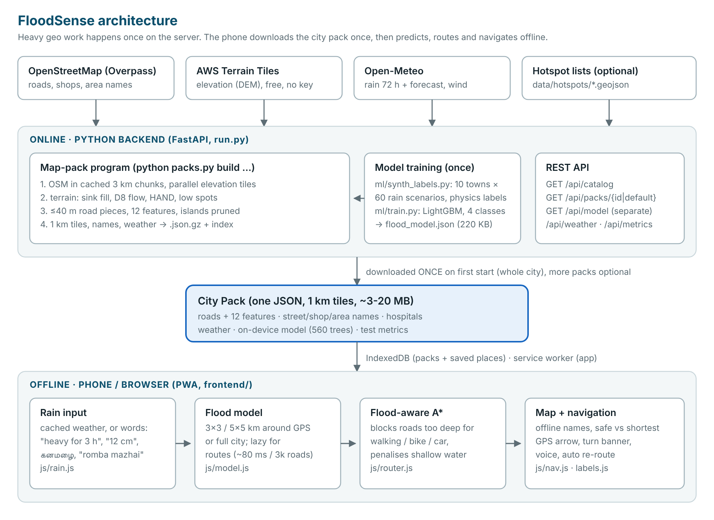

###FloodSense###

***Google Maps tells you the fastest route. FloodSense tells you the safest one, even with no internet.***


FloodSense is a hybrid online/offline AI app. **On first start it asks you to pick your city - any city or town in India, or the ones nearest your GPS - then downloads your whole city once**: roads with street names, shops and area names, elevation-based flood features, weather and a small AI model, **all fetched and assembled on your phone/laptop**. After that it works **without internet**. Around your GPS position (3×3 km, 5×5 km or the full city), it predicts **how deep the water is on every road**. It then plans a route that avoids water too deep for how you're travelling (walking with a child, two-wheeler, or car/ambulance). Finally it **navigates you there like Google Maps**: a GPS arrow, turn banners and voice prompts, re-routing automatically when you go off route.

> Built for a 10-hour hackathon · Problem statement: Smart Cities & Sustainability



| Live navigation (simulated drive) | Phone |
|---|---|
|  |  |

---

## Contents

1. [The problem](#the-problem)
2. [What FloodSense does](#what-floodsense-does)
3. [Architecture](#architecture)
4. [How the AI works](#how-the-ai-works)
5. [City packs, flood view, places and navigation](#city-packs-flood-view-places-and-navigation)
6. [Data sources: training vs prediction](#data-sources)
7. [Tech stack](#tech-stack)
8. [Run it locally (Windows / macOS / Linux)](#run-it-locally)
9. [3-minute demo script](#3-minute-demo-script)
10. [Using a real city, a phone, and your own data](#using-a-real-city-a-phone-and-your-own-data)
11. [API](#api)
12. [Project structure](#project-structure)
13. [How we built it in 10 hours](#how-we-built-it-in-10-hours)
14. [Limitations, safety and what's next](#limitations-safety-and-whats-next)

---

## The problem

It's pouring outside. Someone at home needs a hospital *now*, or you have to carry a child somewhere urgently.

- You don't know **which streets are under water** right now. Google Maps shows traffic, not flood depth.
- The **shortest road is often the worst one**: it can dip through an underpass or a low-lying colony.
- During heavy rain and floods, **mobile data is the first thing to fail**.
- Ordinary people can't say "62 mm of rain". They say *"it poured for 3 hours"* or *"romba mazhai"*.

## What FloodSense does

| | Feature |
|---|---|
| ⬇️ | **Pick your city, download it once on first start**: every city and town in India is built-in (≈3,000 places, all states), plus "near my GPS" - the app fetches OpenStreetMap, elevation and weather itself and assembles the offline map **in your browser**. No city needs to be prepared on a server |
| 🗺️ | **Flood map**: every road is coloured by its predicted water depth: dry, 5–15 cm, 15–30 cm, over 30 cm. **Flood view** covers **3×3 km** or **5×5 km** around your GPS, or the **full city** |
| 🏷️ | **Street, shop and area names offline**: labels drawn from the pack itself, with no tile server needed |
| 🔎 | **Offline search** over streets, shops, areas, hospitals and your saved places |
| 🏠 | **Saved places**: Home, Work and named favourites ("Amma's house") for one-tap routes |
| 🧭 | **Safe route vs shortest path**: the shortest path is **highlighted in purple** with ⚠ pins on every flooded stretch. Switch the focus between Both, Safe and Shortest |
| ▶️ | **Real navigation**: GPS arrow, follow camera, next-turn banner, voice at 200 m and at the turn, "shallow water ahead" warnings, **automatic re-route** when off route, arrival. **Simulate** mode lets you demo it on a laptop |
| 📊 | **Model performance card**: accuracy, F1, missed deep roads, confusion matrix and feature importance, shipped inside the pack so it works offline |
| 🚶 🛵 🚑 | **Travel modes**: walking with a child or elderly person and two-wheelers avoid water over ~15 cm; cars and ambulances avoid water over ~30 cm |
| 🏥 | **Nearest hospital** button: picks the hospital that is *fastest to reach safely*, not the closest one |
| 🗣️ | **Voice + text turn-by-turn**, with "shallow water ahead, go slowly" warnings |
| ✍️ | **Rain in your own words**: "12 cm in 2 days", "poured heavily for 3 hours, then drizzled", **கனமழை 3 மணி நேரம்**, "romba mazhai 2 mani neram" |
| 📴 | **Fully offline** after one download: the map, AI model, routing and voice all run on the device |
| 🌦️ | **Live weather** while online: rain for the past 72 h + next 24 h, wind, gusts, temperature, humidity |
| ❓ | **Explainable**: tap any road to see the depth probabilities and *why* (for example: "underpass · 1.8 m lower than surroundings · 60 mm in last 3 h") |
| 🏞️ | **Dam/lake release** switch: adds risk to low ground near rivers and lakes |

---

## Architecture



*(Editable source: [`docs/architecture.svg`](docs/architecture.svg))*

**Key design decision:** the AI **predicts flood depth per road segment**, and a normal **A\* search** picks the route. An LLM is *not* used for routing: it would be slow, impossible to verify, and could invent roads. The tree model is small (220 KB), runs in the browser in under 100 ms for ~2,500 roads, and every result can be explained.

**Second key decision:** the **whole-city map is built on the device, not on a server**. `js/packlib.js` + `js/cityengine.js` are a faithful port of the backend pipeline, and `tests/test_frontend.mjs` mirrors `tests/test_core.py` test by test - so a pack built in your browser has the **same format and features** as one built by `python packs.py build`. The server never needs a prepared pack.

**Flow**

1. **Phone, first start (online, once):** the app asks you to choose a city - by search, by state, or the ones nearest your GPS - then downloads OpenStreetMap roads/names/shops (Overpass, 3×3 km chunks, 2 mirrors, cached), the city's administrative boundary (Nominatim), elevation tiles (AWS Terrain Tiles) and weather (Open-Meteo) **itself**, runs the full terrain analysis (sink filling, D8 flow, accumulation, HAND, low spots) and segmentation **in a Web Worker**, clips to the city boundary, verifies the result and stores the **City Pack** in **IndexedDB**. Interrupted downloads resume: finished chunks and tiles are cached. A **service worker** caches the app itself.
2. **Phone, offline, every time:** rain comes from cached weather or the user's own words. The on-device model predicts the depth class for every road in the **flood view** (3×3 / 5×5 km around GPS, or the full city). Roads outside it are predicted **lazily**, only when A\* explores them. Then flood-aware A\* → map → live turn-by-turn navigation.
3. **Server (optional, advanced):** the FastAPI backend serves the app, the AI model and live weather, and `python packs.py build …` can still prepare packs on a server (handy for whole states or flaky conference Wi-Fi). **Nothing has to be prepared server-side** - the phone builds its own city.

---

## How the AI works

### 1. Features (per road segment, ≤ 40 m)

| Static: computed once, while building the pack | Dynamic: from weather or user input |
|---|---|
| `elev_m`: ground elevation | `rain_1h`, `rain_3h`, `rain_24h`, `rain_72h` |
| `rel_elev_300m`: height vs the 300 m neighbourhood (negative = low spot) | `rain_fc_3h`: forecast for the next 3 h |
| `depression_m`: how deep water ponds before it spills (priority-flood sink fill) | `reservoir_release`: upstream dam/lake release |
| `hand_m`: Height Above Nearest Drainage | |
| `log_flow_acc`: how much upstream area drains through here (D8) | |
| `slope_deg`, `impervious` (sealed-surface share), `dist_water_m` | |
| `underpass`, `bridge`, `road_code` (major → minor), `hotspot_100m` | |

### 2. Model

- **LightGBM multiclass classifier**, 4 depth classes, 140 rounds × 4 classes = 560 small trees.
- Exported to compact JSON (`models/flood_model.json`, **220 KB**) and run **in plain JavaScript** (`frontend/js/model.js`). No GPU, no ONNX runtime, no internet. `ml/train.py` checks the export against LightGBM itself (max difference ~2e-6).
- Optional ONNX export for a future native app: `python -m ml.export_onnx`.
- If the model file is missing, the app falls back to the **physics rule** below (same inputs, same colours).

### 3. Training labels (honest version)

Almost no city publishes "water depth on this street at this time". So for the hackathon:

1. **10 synthetic towns** with random terrain, rivers, lakes, low colonies, railway underpasses and street grids
2. × **60 rain scenarios** each (dry → extreme, plus dam releases)
3. labelled by a **transparent water-balance rule** (`backend/physics.py`): effective rain × runoff − drain capacity, × water convergence × lowness, + depression ponding, + extra for underpasses, river overflow, dam release and known hotspots
4. with **±30% random noise**, because real streets are messier than any rule

Any **real labels** you add (`ml/labels/real_labels.csv`) are mixed in with 3× weight. That's the path from demo to production.

**Hold-out results** on the original 3×3 km Demo Town (seed 7), which is never seen in training (102,680 road × scenario rows, `models/metrics.json`):

| Metric | Value |
|---|---|
| Accuracy | **92.4%** |
| Macro F1 (4 classes) | **0.79** |
| Deep/impassable roads missed **at the routing threshold** (block if P(≥15 cm) ≥ 40%) | **10.0%** |
| Dry roads wrongly blocked | **0.0%** |
| Most important features | rain 24 h, HAND, rain 72 h, rain 3 h, distance to water, depression depth |

> These scores measure how well the model learned the physics rule plus noise. They do **not** measure real-world accuracy. Real labels are needed for that (see [Limitations](#limitations-safety-and-whats-next)).

### 4. Routing

Each travel mode has a depth it must not cross, plus penalties for water below that limit:

| Mode | Blocked when P(depth ≥ limit) ≥ 40% | Speed |
|---|---|---|
| Walking with child / elderly | ≥ 15 cm | 4 km/h |
| Two-wheeler | ≥ 15 cm | road speed, max 35 km/h |
| Car / ambulance | ≥ 30 cm | road speed, max 50 km/h |

```
cost(road) = travel_time × (1 + 2 · P(≥5 cm) + 8 · P(≥15 cm))      (∞ if blocked)
```

Commonly cited flood-safety guidance says ~15 cm of moving water can knock an adult over and ~30 cm can float many cars. The thresholds are deliberately cautious. If no safe route exists, FloodSense sends you to the **nearest reachable shelter or hospital** instead, or tells you to stay on high ground and call 112.

### 5. Rain parser (offline, `frontend/js/rain.js`)

| You type | FloodSense understands |
|---|---|
| `poured heavily for 3 hours, then drizzled 2 hours` | 60 mm + 2 mm, the drizzle most recent |
| `12 cm in 2 days` · `40 mm in 2 hours` · `2 inches` | unit conversion |
| `கனமழை 3 மணி நேரம்` · `romba mazhai 2 mani neram` | Tamil / Tanglish → heavy, 3 h / 2 h |
| `heavy rain for 4 hours, stopped 2 hours ago` | dry gap, so the last hour = 0 mm |
| `very heavy 6 hours and still raining` | adds a 3-hour forecast |
| `dam gates opened` | turns on reservoir release |

Approximate rates: drizzle 1 · light 2.5 · moderate 6.5 · heavy 20 · very heavy 40 · cloudburst 100 mm/h. FloodSense always shows the parsed mm back to the user, so they can correct it.

---

## City packs, flood view, places and navigation

### City pack format (v2)

One JSON file per city or area (`data/packs/<id>.json`):

| Key | What it holds |
|---|---|
| `segments[]` | road pieces ≤ 40 m: geometry, street name, road type, one-way, **12 model features**, **tile `t`** |
| `nodes[]` | junctions (routing graph) |
| `tiles` | 1 km grid: `nx`, `ny`, bounds of each tile, used for the 3×3 / 5×5 km flood view |
| `places[]` | area names (suburb, neighbourhood, locality) → map labels + search |
| `shops[]` | named shops and amenities (pharmacy, bakery, ATM, fuel, temple…) → map labels + search |
| `pois[]` | hospitals, shelters, fire stations used for "Nearest hospital" and fallback routing |
| `water[]`, `hotspots[]` | rivers, lakes, railway, known flood spots |
| `weather` | last 72 h + next 24 h rain, wind, temperature |
| `model`, `model_metrics` | the 220 KB on-device model and its hold-out test scores (added when served) |

The **Demo City** (`demo-city`) is 6 × 6 km = 36 tiles: ~11,000 road segments, 16 area names, 240 shops, 6 hospitals and 4 shelters.

### Flood view (3×3 km, 5×5 km, full city)

- The view is centred on your **GPS** (or the map centre). During navigation it **follows you** tile by tile.
- Only roads in the view are predicted and coloured: ~2,800 roads in about 100 ms for 3×3 km. Roads outside it are drawn grey ("not analysed").
- **Routing never ignores flooding outside the view.** The predictor is *lazy*: when A\* reaches a road, that road is predicted on the spot (`createPredictor()` in `js/model.js`). Results are identical to predicting everything (checked in the tests).
- **Full city** predicts all ~11,000 Demo City roads in ~0.25 s.

### Offline map labels (`js/labels.js`)

Everything comes from the pack, so it works with no tile server:
- **Area names:** zoom 12–16
- **Street names:** rotated along the road, one per street every ~350 m, no overlaps, from zoom 15
- **Shops and amenities:** icon dots from zoom 16, with names from zoom 17

When online, OpenStreetMap background tiles are added under real (non-synthetic) packs.

### Saved places and search (`js/places.js`, IndexedDB `places` store)

- **Home** and **Work** (one each) and any number of **favourites** with your own names.
- Save from **GPS**, a **point on the map**, a **map popup** ("★ Save"), or **★ Save destination**.
- Saved places appear as quick chips in the Trip card (one tap = route there), as map markers, and at the top of search.
- **Search** covers streets, area names, shops, hospitals/shelters and saved places, fully offline. *Enter* = go to the first result; **From** = start from it.

### Live navigation (`js/nav.js`)

| Feature | How |
|---|---|
| GPS arrow + follow camera | `watchPosition` (high accuracy), arrow rotated by GPS heading or road direction, accuracy circle |
| Next-turn banner | distance to the next turn, turn arrow, street name, "Then: …". Turns **orange when the stretch has shallow water** |
| Voice | "In 200 m, turn left onto …" and again at ~35 m. "Caution: shallow water ahead on …" |
| Off route | more than 40 m off the route for 2 fixes → **re-route from where you are** (safe route) |
| Rain changes mid-trip | map re-predicted and route recomputed from the current position |
| Arrival | within 20 m → "You have arrived". The screen stays awake (Wake Lock) while navigating |
| Simulate | drives along the route at 4× speed so you can demo it on a laptop |

### Shortest path highlight

The shortest path is drawn **purple with a white casing**. Its flooded stretches glow red, with pulsing ⚠ pins and tooltips ("Flooded: Indira Nagar St · Deep (15-30 cm)"), and a map tag shows "Shortest · 2.0 km · 14 flooded". The **Both / Safe route / Shortest path** switch brings one route forward, fades the other and zooms to it.

---

## Data sources

### For training (collected once)

| Need | Used in this build | Production upgrade |
|---|---|---|
| Flood labels | Synthetic towns + physics rule + noise | Sentinel-1 SAR flood maps of past events (Copernicus EMS, Global Flood Database), city waterlogging hotspot lists, geotagged news reports (Chennai: Dec 2015, Nov 2021, Dec 2023) → `ml/labels/real_labels.csv` |
| Rain on event days | Generated scenarios | IMD gridded rainfall (`imdlib`), GPM IMERG, Open-Meteo historical API |
| Elevation | Synthetic DEM | Copernicus GLO-30 / SRTM / **FABDEM** (buildings removed), CartoDEM (Bhuvan) |
| Drainage / HAND | Computed (`backend/terrain.py`) | MERIT Hydro |
| Land cover | Synthetic urban gradient | ESA WorldCover 10 m |
| Water bodies | Synthetic river + lake | JRC Global Surface Water, OSM |

### For prediction (live, downloaded by the BROWSER while building your city map)

| Need | Source | When |
|---|---|---|
| Location | Browser Geolocation API | on demand |
| City catalogue (every city/town in India) | **built-in** `js/india_cities.js`, generated from the GeoNames cities5000 dump (CC BY 4.0) with `python tools/make_city_catalog.py` | offline |
| City administrative boundary | **Nominatim** (1 request; falls back to a sized box) | city build |
| Roads, underpasses, bridges, rivers, hospitals, shelters | **OpenStreetMap** via the Overpass API (5 public mirrors, retries, chunk cache; last resort: this server's `/api/overpass` relay) | city build |
| Street names, area names (`place=*`), named shops and amenities | **OpenStreetMap** via the Overpass API (map labels + search only, not model features) | city build |
| Elevation | **AWS Terrain Tiles** (Terrarium, zoom 14, free, no key, CORS-enabled) | city build |
| Rain past 72 h + next 24 h, wind, gusts, temperature, humidity | **Open-Meteo** (free, no key; falls back to this server's `/api/weather`) | city build + Refresh |
| Known waterlogging hotspots | Your GeoJSON files in `data/hotspots/` | server-side builds (`packs.py`) |
| Sealed surface | Proxy from road density (`terrain.impervious_from_roads`) | city build |
| Dam release | User switch / words ("dam gates opened") | offline |
| Rain when offline | **User's own words** or the last cached weather | offline |

---

## Tech stack

| Layer | Choice |
|---|---|
| Backend | **Python 3.10+**, FastAPI, Uvicorn |
| Geo + terrain | NumPy, SciPy (no GDAL needed): priority-flood sink fill, D8 flow, HAND, written from scratch |
| ML | LightGBM, scikit-learn; optional onnxmltools |
| Data APIs | Overpass (OSM), AWS Terrain Tiles, Open-Meteo, all free with no API key |
| Frontend | Vanilla JS ES modules (no build step), **Leaflet** (bundled, so it works offline) |
| City maps | **built on the device**: the first-start picker (all of India / near GPS) drives `js/cityengine.js` in a Web Worker - Overpass chunks + elevation tiles + boundary + weather, all with retries, timeouts, mirror fallback and an IndexedDB resume cache |
| Map packs (advanced) | `packs.py` CLI: chunked + cached Overpass downloads, parallel elevation tiles, island pruning, checks; pre-gzipped files + `index.json` catalogue - for server-side builds |
| Offline | Service worker (app shell; never hijacks cross-origin data requests), IndexedDB (packs + small meta records + saved places + download cache), persistent storage request, lazy tile-based drawing and prediction |
| Navigation | Geolocation `watchPosition`, Screen Wake Lock, route snapping + re-routing (`js/nav.js`) |
| On-device AI | Tree-ensemble evaluator in JS (~40 lines) |
| Voice | Web Speech API (`speechSynthesis`) |
| Tests | pytest (18 tests: live builder end-to-end with mocked APIs, Overpass chunking, pack store, API incl. the overpass relay, pack verification, a fingerprint check that training data is unchanged, and a guard that the browser-builder files ship offline) + Node test script (35 tests: the same rain/model/routing tests, plus the browser-side builder - terrain, Terrarium decoding, OSM parsing, boundary resolution, full build with mocks, the India catalogue, and the Overpass fetch ladder: mirror probe, dead mirrors -> server relay, sticky relay, hanging-mirror fast-forward, native skip) |

---

## Run it locally

You need **Python 3.10–3.13**. Node.js is optional (only for the JS tests). The trained model and the demo area are already included, so **no internet is needed** to run the demo.

### Windows (PowerShell)

```powershell
cd floodsense
python -m venv .venv
.\.venv\Scripts\Activate.ps1          # if blocked: Set-ExecutionPolicy -Scope CurrentUser RemoteSigned
pip install -r requirements.txt
python run.py
```

### macOS / Linux

```bash
cd floodsense
python3 -m venv .venv && source .venv/bin/activate
pip install -r requirements.txt
python run.py
```

The browser opens **http://localhost:8000**. On first start it asks you to **pick your city** (search, browse by state, or the ones nearest your GPS), then downloads and builds your whole-city flood map on the device (internet needed once; typically 1–4 min for a mid-size city). From then on it works offline.

### Useful commands

```bash
python run.py --port 8080 --no-browser   # different port, don't open a browser
python -m ml.synth_labels                # regenerate training data (~10 s)
python -m ml.train                       # retrain + export the model (~15 s) -> models/
python -m ml.export_onnx                 # optional ONNX export
python tools/make_city_catalog.py        # regenerate the built-in India city catalogue (needs internet, ~3 MB download)
python packs.py presets                  # ready-made city presets (Chennai areas, Coimbatore, Madurai, ...)
python packs.py build --preset chennai-velachery --default
                                         # build a REAL city pack once on the server (optional; phones build their own)
python packs.py list                     # packs this server offers
python -m pytest -q                      # backend tests
node tests/test_frontend.mjs             # parser / model / routing + browser builder tests (Node 18+)
python tools/dev_mock_apis.py            # deterministic mock Overpass/Nominatim/elevation/weather on :8001,
                                         #   for testing the browser builder without rate limits (see below)
```

After retraining, reload the page and pick the pack again (or delete it with ✕ and reload) to pick up the new model.

---

## 3-minute demo script

1. **Open** `http://localhost:8000` in a fresh browser (or an incognito window). The **Welcome** screen asks you to **pick your city** - type "Chennai", or use **⌖ Near me**, or browse by state. Press **⬇ Download my city map**: the app downloads OpenStreetMap + elevation + weather for the **whole city** and builds the flood map on the device. *("Nothing was prepared on a server - your phone did all of this.")* Or press **▶ Demo City** for the synthetic town that works without internet.
2. **Go offline:** tick **Offline** (top right of the panel), or switch off Wi-Fi. *"No internet from here on."*
3. Point at the **dashed blue square** and the **▦ 3×3 km** chip: *"This is the flood view around me: 2,800 roads analysed on the phone in about 0.1 s."* Zoom in to show **street, shop and area names**, all offline.
4. **Route tab → ▶ Load demo scenario.** This sets rain = *"poured heavily for 3 hours"*, mode = 🚶 *walking with child*, and Home → Government General Hospital.
   - **Purple:** the **shortest path, 2.0 km, crosses 14 flooded stretches** (red glow + ⚠ pins).
   - **Blue:** the **safe route, 2.8 km / 41 min**, going around.
   - Click **Shortest path** in the switch to spotlight it, then **Both** again.
5. **Tap a red road**: probability bars + *why* it floods (underpass, low spot, rain).
6. Press **Simulate**: the GPS arrow drives the route, with the turn banner ("In 200 m, turn right onto …"), voice, and an orange banner on shallow stretches. Press **Stop**.
7. Type "medic" in the **B** box: offline search finds the shops. Press **★ Save destination**. *"One-tap routes next time."*
8. **Rain tab → Drizzle 2 h**: the map turns green and the route becomes the shortest path. *"Same AI, it reacts to the rain."*
9. **Heavy 3 h**, then **Route tab → 🏥 Nearest hospital**. Walking with a child, it's Government General (2.8 km). Tap 🚑 **Car / ambulance** and press it again: **Sri Ramana Clinic, 1.3 km**, because a car can handle water a walker can't.
10. **Maps tab**: maps on the device, and **Build a map for any city in India** (the same picker as first start, plus custom areas). *"Any city or town in India, built right here on the phone - nothing is prepared on the server."* The server-prepared packs section stays available for admins.
11. **Model tab**: 92.4% accuracy on a town never seen in training, confusion matrix, and what the model relies on. *"Honest note: trained on synthetic towns with physics labels; real flood records are the next step."*

Closing line: *"Downloads your city once, works offline, explains every red road, and navigates you around the water."*

---

## Using a real city, a phone, and your own data

**Your city map is built by the browser, not by a server.** On first start (and in the **Maps tab**) the app offers every city and town in India - search, browse by state, or **⌖ Near me** for the ones closest to your GPS. Picking one downloads the city's administrative boundary (Nominatim), OpenStreetMap roads/names/shops/hospitals (Overpass), elevation tiles (AWS Terrain Tiles) and weather (Open-Meteo), then runs the same terrain pipeline as the server - sink fill, D8 flow, HAND, low spots, sealed-surface proxy - **in a Web Worker**, clips everything to the city boundary, verifies it, and saves it in IndexedDB. Interrupted builds **resume** (finished chunks and tiles are cached), a **whole state** is honestly offered as a capped region map around its biggest city, and a **custom area** builder (GPS or map centre, 1–30 km) covers anything that isn't a whole city.

`packs.py` remains the **server-side** path for the same result - handy for whole states, hotel Wi-Fi, or pre-seeding many phones:

```bash
python packs.py presets                                    # list ready-made cities
python packs.py build --preset chennai-velachery --default # real city pack, downloadable by phones (optional)
python packs.py build --place "Anna Nagar, Chennai" --radius-km 3
python packs.py build --name "My Street" --lat 13.04 --lon 80.23 --radius-km 1.5 --kind area
python packs.py list                                       # what phones can download (* = default)
python packs.py verify --all                               # check every pack (corrupt, fragmented, no hospitals, ...)
python packs.py refresh-weather --all                      # update the weather snapshot inside packs
python packs.py set-default <id> · delete <id> · demo · reindex
```

What the **browser builder** (`js/cityengine.js`) and `packs.py build` both do, and why it holds up on a whole city:

| Step | Detail |
|---|---|
| Boundary | Nominatim admin polygon (city builds); the map is **clipped to the boundary**. Falls back to a city-sized box; very large regions are capped (30×30 km) with a clear warning |
| OpenStreetMap | Roads, names, shops, area names, hospitals, rivers, parks, fetched in **3 × 3 km chunks**. Each chunk is **cached** (IndexedDB in the browser, disk on the server), so an interrupted build **resumes**. Requests are **retried across the 5 public mirrors** with back-off and timeouts; if the browser's own network blocks every mirror (college or office Wi-Fi), the download is **relayed through the FloodSense server** (`POST /api/overpass`) as a last resort. Parking aisles, driveways and private service roads are skipped. `oneway=-1` is handled. Non-Overpass responses are rejected, so a captive portal can't poison the build |
| Elevation | AWS Terrain Tiles (CORS-enabled), **fetched in parallel** (6–8 at a time), retried, cached, PNG-magic-verified, decoded in the worker |
| Terrain | Sink filling, flow, HAND, low spots. Lakes are **filled polygons**, not just outlines. Big cities coarsen the grid to stay around 1000 × 1000 cells |
| Clean-up | **Disconnected road fragments are removed**, so a pin can't snap onto a cut-off private lane and give "no route" |
| Checks | `verify` runs on every build: broken junctions, invalid features, fragmented network, missing hospitals, missing weather, too many unnamed roads; warnings are shown after the build |
| Output | A **version-2 City Pack** in IndexedDB - identical in shape to a server pack - plus the 220 KB AI model, so the whole thing works offline at once |

**In the app (Maps tab):** *On this device* shows every saved map with **Open** and **Delete**. *Build a map for any city in India* is the same picker as first start (search / near me / by state / custom area) with live progress. The optional **server-prepared packs** card lists anything an admin built with `packs.py` (with **Update** when the server has a newer build, compared by checksum). *Storage* shows space used, the download cache (with **Clear download cache**) and **Keep maps safe**, which asks the browser for persistent storage so maps aren't cleared on a full phone. Downloads are checksum-verified and parsed before they're saved. On start, the app opens the map that contains your GPS position.

**Testing the city builder without rate limits:** `python tools/dev_mock_apis.py` runs deterministic mock Overpass/Nominatim/elevation/weather endpoints on `:8001`; open the app with
`?nominatim-url=http://localhost:8001/nominatim/search&overpass-url=http://localhost:8001/overpass&tiles-url=http://localhost:8001/tiles/{z}/{x}/{y}.png&meteo-url=http://localhost:8001/meteo`
to build a mock city end-to-end with no internet and no rate limits.

**Background map (online, real packs):** *Clean* (CARTO light, no labels, so FloodSense's flood colours and its own names stay readable; the default), *OpenStreetMap* (FloodSense hides its own street and area labels to avoid doubles), or *None*. Synthetic Demo City never shows a background, because its roads are made up.

**On a phone:** browsers only allow GPS, offline caching and Wake Lock on `https://` or `localhost`.
- Easiest: `ngrok http 8000` and open the `https://…` link on the phone, then *Add to Home screen*.
- Or open `http://<laptop-ip>:8000` (printed by `run.py`). Maps work, but GPS and offline caching won't.
- For navigation without walking around: **Simulate**, or Chrome DevTools → *Sensors* → set a location.

**Known hotspots:** drop GeoJSON Point files into `data/hotspots/` (format in `data/hotspots/README.md`). Packs built afterwards flag roads within 100 m.

**Real flood labels:** add rows to `ml/labels/real_labels.csv` (format in `ml/labels/README.md`), then run `python -m ml.synth_labels && python -m ml.train`.

---

## API

Interactive docs: **http://localhost:8000/docs**

| Method | Endpoint | Returns |
|---|---|---|
| GET | `/api/health` | status, model version, default pack, pack ids |
| GET | `/api/catalog` | everything a phone needs: default pack id, model version, all packs (size, checksum, bbox, counts) |
| GET | `/api/packs` | catalogue of city/area packs (default first): name, kind, size, segments, shops |
| GET | `/api/packs/{id}` · `/api/packs/default` | the pre-compressed pack file (`X-Pack-Bytes` = real size for progress, `X-Pack-Sha` = checksum) |
| GET | `/api/weather?lat=&lon=` | current + past 72 h + next 24 h |
| POST | `/api/overpass` | last-resort relay for one Overpass QL query - used by the browser builder when its own network blocks every public mirror (fixed mirror list, `[out:json]` only, never a general proxy) |
| GET | `/api/model` · `/api/metrics` | the exported model · its hold-out test scores |

Prediction and routing **never** call the server.

---

## Project structure

```
floodsense/
├─ run.py                     # one-command launcher
├─ packs.py                   # map-pack program: build / list / verify / update / delete packs (server-side, optional)
├─ requirements.txt
├─ tools/
│  ├─ make_city_catalog.py    # regenerate js/india_cities.js from the GeoNames dump
│  └─ dev_mock_apis.py        # deterministic mock Overpass/Nominatim/elevation/weather for offline E2E tests
├─ backend/
│  ├─ main.py                 # FastAPI app + serves the web app
│  ├─ features.py             # feature order, road classes, depth classes (shared with JS)
│  ├─ geo.py                  # local projection + raster grid
│  ├─ terrain.py              # sink fill, D8 flow, accumulation, HAND, low spots
│  ├─ physics.py              # transparent water-balance rule (labels + fallback)
│  ├─ pack_core.py            # roads + terrain -> pack v2 (tiles, names, shops; shared by demo & live)
│  ├─ pack_builder.py         # live builder (server): Overpass + Terrain Tiles + Open-Meteo
│  ├─ pack_store.py           # pack files, .gz copies, index.json catalogue, default pack
│  ├─ weather.py              # Open-Meteo client
│  └─ demo_city.py            # synthetic 6x6 km Demo City (+ shops, areas) and training towns
├─ ml/
│  ├─ synth_labels.py         # training table (synthetic + real labels)
│  ├─ train.py                # LightGBM -> models/flood_model.json + metrics
│  ├─ export_onnx.py          # optional ONNX export
│  └─ labels/README.md        # format for real labels
├─ models/                    # flood_model.json (browser), .txt (LightGBM), metrics.json
├─ data/
│  ├─ packs/                  # demo-city.json (+ any optional server-built packs) + index.json
│  ├─ hotspots/               # optional known waterlogging points (GeoJSON; server builds)
│  └─ cache/                  # downloaded tiles / weather (server builds)
├─ frontend/                  # offline PWA (no build step)
│  ├─ index.html, css/style.css, sw.js, manifest.webmanifest
│  ├─ js/app.js               # UI, trip, route focus, wiring
│  ├─ js/india_cities.js      # built-in catalogue: ~3,000 Indian cities/towns, all states (generated)
│  ├─ js/citybuild.js         # first-start + Maps-tab UI: city picker, build progress, save
│  ├─ js/cityworker.js        # Web Worker entry for the city builder
│  ├─ js/cityengine.js        # browser builder: Overpass/Nominatim/tiles/weather + retries + resume cache
│  ├─ js/packlib.js           # pure port of the backend pipeline (terrain, OSM parsing, pack v2, verify)
│  ├─ js/roads.js             # tile-based road drawing + 3x3 / 5x5 / full flood view
│  ├─ js/labels.js            # offline street / shop / area names
│  ├─ js/places.js            # offline search + saved-place helpers
│  ├─ js/packs.js             # server-pack downloads (progress, checksum), updates, model sync, storage
│  ├─ js/nav.js               # live turn-by-turn navigation (GPS arrow, re-route)
│  ├─ js/metrics.js           # model performance card
│  ├─ js/model.js             # on-device model (lazy predictor) + explanations
│  ├─ js/physics.js           # JS twin of the physics rule
│  ├─ js/router.js            # flood-aware A*, nearest hospital, directions
│  ├─ js/rain.js              # rain words / Tamil / units -> mm
│  ├─ js/db.js, js/voice.js   # IndexedDB (packs, places, settings, download cache) · speech
│  └─ vendor/leaflet/         # bundled so maps work offline
├─ docs/                      # architecture.svg/.png, screenshots
└─ tests/                     # test_core.py (pytest), test_frontend.mjs (node)
```

---

## How we built it in 10 hours

| Hours | Work |
|---|---|
| 0:00–0:45 | Scope freeze, Area Pack format, repo skeleton |
| 0:45–2:30 | Terrain analysis (sink fill, D8, HAND), road segmentation, demo town generator |
| 2:30–4:30 | Physics rule, synthetic labels, LightGBM training, JSON export + parity check |
| 4:30–6:00 | Browser model, flood-aware A\*, map colouring, live OSM / DEM / weather builder |
| 6:00–8:00 | Offline (service worker + IndexedDB), rain parser (EN / Tamil / Tanglish), voice, nearest hospital, explanations |
| 8:00–9:00 | Tests, offline airplane-mode run-through, demo scenario |
| 9:00–10:00 | README, architecture diagram, pitch rehearsal |

---

## Limitations, safety and what's next

**Safety:** FloodSense gives *risk estimates*, not guarantees. Always follow official warnings (IMD, district administration). Never walk or drive into water when you can't see the road.

**Honest limitations**
- The model is trained on **synthetic towns + a physics rule**. Its scores show that it learned the rule, not that it is accurate on real streets. Real labels are the #1 next step.
- 30 m elevation data (SRTM-class) is coarse for city streets. FABDEM or city LiDAR would help a lot.
- Storm-drain capacity is rarely public, so it is approximated from road class + sealed surface.
- The live builders were tested against **mocked** Overpass / Terrain Tiles / Open-Meteo responses (`tests/test_core.py` for the server, `tests/test_frontend.mjs` for the browser builder, which mirrors it test by test), and the full browser path was run end-to-end against `tools/dev_mock_apis.py`. Do a real run with internet before the judging, and keep the demo pack as a backup.
- Offline, the map is drawn from the pack: roads, water, names and shops. There are no building footprints or satellite imagery. OpenStreetMap background tiles appear only for real packs while online.
- Shop and area names come from OpenStreetMap, so coverage depends on how well your city is mapped.
- Navigation is north-up (the arrow rotates, the map doesn't). Phone GPS in dense areas can be ±20 m off, so the off-route threshold is 40 m.
- A whole-city browser build for a big metro (10 km radius) can be 20+ MB and take 10+ minutes on a phone; the picker shows an honest estimate first, and very large regions are capped at 60 × 60 km (a whole state won't fit on a phone as one offline map - use `packs.py` on a server for that, or build the region around your city).
- Overpass is a free public service: big cities mean many 3×3 km chunks. The builder retries across mirrors with back-off and resumes from the chunk cache, but peak hours can still be slow.

**Next**
- Train on real labels: Sentinel-1 flood extents + Greater Chennai Corporation hotspot lists + crowd reports
- In-app "this road is flooded" reports that sync when online and override the model
- Reservoir levels feed (Chennai Metrowater lake levels, CWC bulletins)
- Native Android build with ONNX Runtime Mobile and offline Tamil voice

## Credits & licences

Road data © OpenStreetMap contributors (ODbL) · Boundary: Nominatim (OSM) · Elevation: AWS Terrain Tiles (Mapzen/Tilezen, sources incl. SRTM) · Weather: Open-Meteo (CC BY 4.0) · City catalogue: GeoNames (CC BY 4.0) · Map library: Leaflet (BSD-2-Clause).
